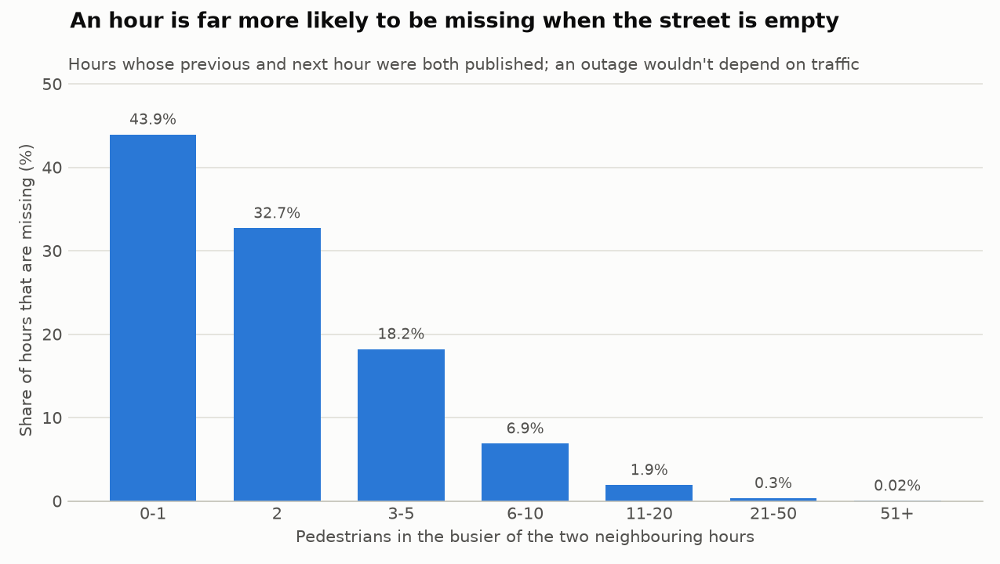
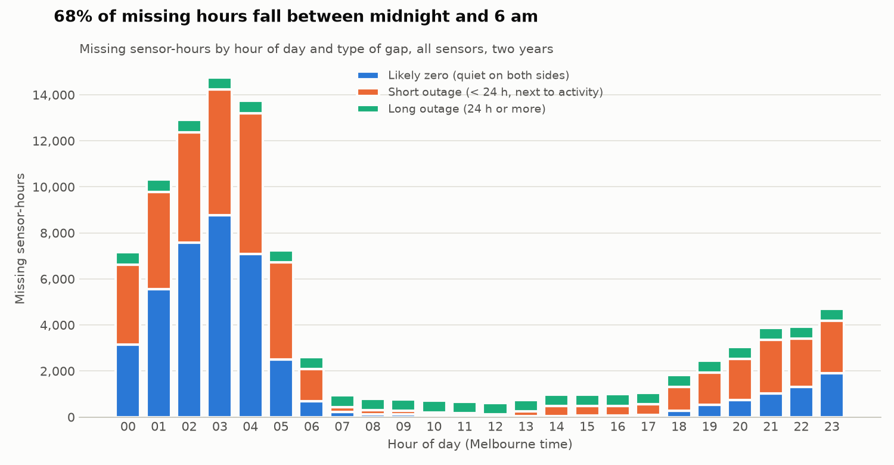
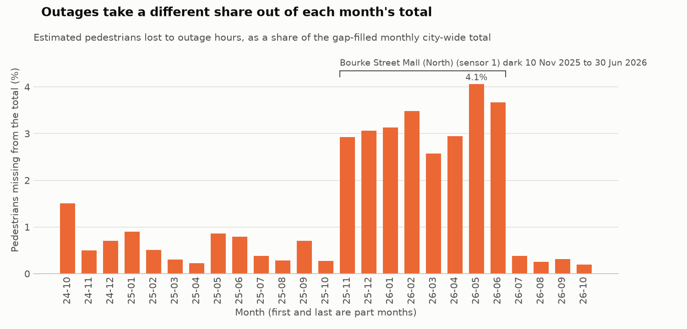

# Completeness deep dive

Snapshot `2026-10-18T1539Z` (2024-10-19 to 2026-10-18; the newest, partial day is left out). Generated by `scripts/completeness.py`.

## 1. What the missing hours are

97,805 of 1,724,153 expected sensor-hours are missing (5.7%). Each run of consecutive missing hours for one sensor is one gap, classed by its length and by the published counts just before and after it (quiet = at most 5 people an hour):

| Type of gap | Gaps | Missing hours | Share of missing hours |
|---|---|---|---|
| Likely zero (quiet on both sides) | 18,063 | 42,027 | 43.0% |
| Short outage (< 24 h, next to activity) | 11,685 | 43,434 | 44.4% |
| Long outage (24 h or more) | 68 | 12,344 | 12.6% |

## 2. Evidence that quiet gaps are unpublished zeros

- The feed has **143** hours with a count of 0 but **33,999** with a count of 1. Where a street is quiet enough to log exactly one person in an hour that often, an hour with nobody should be about as common, so most zero hours aren't being published.
- For every expected hour whose previous and next hour were both published, the chance that it is missing rises steeply as the street gets quieter. An outage (power, network, a broken sensor) doesn't depend on how many people walk past; a dropped zero does.

| Busier neighbouring hour (people) | Hours | Missing | Missing % |
|---|---|---|---|
| 0-1 | 4,448 | 1,954 | 43.93% |
| 2 | 8,170 | 2,671 | 32.69% |
| 3-5 | 27,464 | 4,999 | 18.20% |
| 6-10 | 42,604 | 2,929 | 6.87% |
| 11-20 | 71,507 | 1,364 | 1.91% |
| 21-50 | 145,049 | 474 | 0.33% |
| 51+ | 1,287,156 | 208 | 0.02% |

## 3. Effect on hourly averages

Average pedestrians per sensor-hour, by hour of day: over published hours only (what a naive `avg()` gives) and with likely-zero gaps counted as 0. Outage hours are left out of both.

| Hour | Published only | Likely zeros as 0 | Published-only overstates by |
|---|---|---|---|
| 00:00 | 93.4 | 89.0 | 4.9% |
| 01:00 | 57.7 | 52.9 | 9.0% |
| 02:00 | 37.0 | 32.7 | 12.9% |
| 03:00 | 28.1 | 24.4 | 15.3% |
| 04:00 | 20.8 | 18.6 | 12.2% |
| 05:00 | 30.7 | 29.5 | 3.9% |
| 06:00 | 82.2 | 81.4 | 1.0% |
| 07:00 | 191.6 | 191.1 | 0.3% |
| 08:00 | 410.1 | 409.3 | 0.2% |
| 09:00 | 384.4 | 383.8 | 0.2% |
| 10:00 | 428.6 | 428.1 | 0.1% |
| 11:00 | 533.3 | 532.8 | 0.1% |
| 12:00 | 738.2 | 737.7 | 0.1% |
| 13:00 | 752.9 | 752.5 | 0.1% |
| 14:00 | 683.3 | 682.8 | 0.1% |
| 15:00 | 686.4 | 685.9 | 0.1% |
| 16:00 | 737.7 | 737.2 | 0.1% |
| 17:00 | 819.4 | 818.5 | 0.1% |
| 18:00 | 664.4 | 661.8 | 0.4% |
| 19:00 | 528.5 | 524.6 | 0.8% |
| 20:00 | 433.8 | 429.1 | 1.1% |
| 21:00 | 369.1 | 363.6 | 1.5% |
| 22:00 | 288.1 | 282.6 | 1.9% |
| 23:00 | 179.2 | 174.2 | 2.8% |

The biggest overstatement is at 03:00 (15.3%); between 09:00 and 17:00 it is at most 0.16%.

## 4. Effect on daily and monthly totals

Likely zeros don't change a total. Outage hours do: each is filled with the median of the same sensor at the same hour on the same weekday 1–4 weeks either side, or, for long outages with no such readings, the same weekday and hour over the whole snapshot.

| Estimate used for outage hours | Hours |
|---|---|
| same weekday +/- 4 weeks | 33,747 |
| same weekday, whole snapshot | 19,940 |
| none: no published reading for that sensor, weekday and hour in two years (counted as 0) | 2,091 |

The 2,091 outage hours with no history are at 4 sensors that have never published that weekday and hour, which itself points to a count of 0.

- Over the whole snapshot, outage hours hold an estimated **1.43%** of all pedestrians.
- Across 729 days, the city-wide daily total is short by a median of 0.54% (90th percentile 3.44%); 20 days are short by more than 5%; the worst is 2026-06-27 at 7.9%.
- By month the shortfall ranges from 0.20% to 4.06%. The biggest gap between the published and the gap-filled month-on-month change is 2026-07: +15.0% published vs +11.2% gap-filled (-3.8 points).
- Like-for-like, over the 26 sensors with no outage hour in 2026-06 or 2026-07, the change is +13.0%. A month-on-month figure from the raw totals mixes real change with sensors going dark or coming back.

Most of the shortfall comes from a few sensors:

| Sensor | Description | Share of estimated missing pedestrians | Outage gaps | Longest outage | Most common outage |
|---|---|---|---|---|---|
| 1 | Bourke Street Mall (North) | 57.8% | 2 | 5,570 h (2025-11-10 07:00 to 2026-06-30 08:00) | n/a |
| 37 | Lygon St (East) | 11.3% | 826 | 9 h (2026-10-11 14:00 to 2026-10-11 22:00) | 9 h from 14:00, 218 times |
| 48 | QVM-Queen St (East) | 2.5% | 544 | 86 h (2026-06-21 18:00 to 2026-06-25 07:00) | 7 h from 23:00, 152 times |

| Month | Published | Estimated missing | Short by |
|---|---|---|---|
| 2024-10 | 10,838,633 | 165,746 | 1.51% |
| 2024-11 | 25,086,232 | 125,856 | 0.50% |
| 2024-12 | 27,587,193 | 195,307 | 0.70% |
| 2025-01 | 25,161,116 | 228,590 | 0.90% |
| 2025-02 | 23,145,563 | 118,476 | 0.51% |
| 2025-03 | 29,269,911 | 87,860 | 0.30% |
| 2025-04 | 27,617,480 | 62,144 | 0.22% |
| 2025-05 | 25,456,488 | 221,286 | 0.86% |
| 2025-06 | 22,432,026 | 179,398 | 0.79% |
| 2025-07 | 27,127,806 | 102,637 | 0.38% |
| 2025-08 | 28,594,631 | 81,900 | 0.29% |
| 2025-09 | 26,409,033 | 186,124 | 0.70% |
| 2025-10 | 29,697,417 | 80,858 | 0.27% |
| 2025-11 | 26,863,980 | 808,262 | 2.92% |
| 2025-12 | 29,986,800 | 947,218 | 3.06% |
| 2026-01 | 26,889,148 | 868,529 | 3.13% |
| 2026-02 | 25,104,378 | 906,049 | 3.48% |
| 2026-03 | 30,443,965 | 805,498 | 2.58% |
| 2026-04 | 28,989,679 | 878,998 | 2.94% |
| 2026-05 | 26,514,330 | 1,122,686 | 4.06% |
| 2026-06 | 23,383,414 | 890,563 | 3.67% |
| 2026-07 | 26,885,468 | 101,587 | 0.38% |
| 2026-08 | 27,144,049 | 68,286 | 0.25% |
| 2026-09 | 27,400,828 | 87,068 | 0.32% |
| 2026-10 | 15,911,013 | 31,601 | 0.20% |

### How good is the estimate?

The same method was run on every *published* hour (it never uses the same day's reading), and compared with what was actually counted:

- one hour (hours with 20+ people, 1,344,425 of them): median error 13.4%;
- a whole sensor-day (all 24 hours estimated, 48,857 sensor-days): median error 7.7%, 90th percentile 27.6%, overall bias -1.1%.

So the estimate is good enough to size the shortfall in a total, not to stand in for a specific sensor's specific day.

## 5. Sensors with the most missing hours

| Sensor | Description | Missing | Likely zero h | Short outage h | Long outage h | Total short by |
|---|---|---|---|---|---|---|
| 124 | Birrarung Marr East - Batman Ave Bridge Entry | 55.0% | 5,906 | 2,853 | 25 | 11.3% |
| 140 | COM Pole 2837 - Boyd Park | 41.9% | 558 | 6,769 | 0 | 4.1% |
| 138 | COM Pole 1671 - Enterprize Park, Queens Bridge | 40.3% | 4,106 | 2,945 | 0 | 4.2% |
| 1 | Bourke Street Mall (North) | 31.8% | 0 | 1 | 5,570 | 31.2% |
| 123 | Birrarung Marr East - Batman Ave Bridge Entry | 31.6% | 1,992 | 3,538 | 0 | 1.6% |
| 37 | Lygon St (East) | 25.9% | 96 | 4,441 | 0 | 46.9% |
| 188 | RMIT Building 51 - 80-92 Victoria Street | 25.3% | 1,397 | 823 | 0 | 0.2% |
| 48 | QVM-Queen St (East) | 24.9% | 1 | 3,581 | 774 | 5.2% |
| 46 | Pelham St (South) | 20.3% | 2,126 | 1,424 | 0 | 0.2% |
| 137 | COM Pole 2353 - Towards the city, NAB Building | 16.9% | 2,121 | 817 | 26 | 0.3% |
| 136 | COM Pole 1120 - Towards the City, Near Federation Square Bridge | 16.5% | 1,586 | 1,027 | 270 | 0.9% |
| 180 | Pumping Station No.2, 330 Macaulay Road | 16.4% | 1,674 | 632 | 0 | 0.6% |

Full list: `completeness_sensors.csv`.

## 6. Sensitivity to the quiet threshold

| Quiet = at most | Likely zero h | Short outage h | Long outage h | City-wide total short by |
|---|---|---|---|---|
| 2 people/h | 20,800 | 64,661 | 12,344 | 1.44% |
| 5 people/h | 42,027 | 43,434 | 12,344 | 1.43% |
| 10 people/h | 55,259 | 30,202 | 12,344 | 1.43% |

The threshold moves hours between `likely_zero` and `short_outage`, but those hours are quiet either way, so the city-wide shortfall barely moves.

## 7. Also noticed: the hour daylight saving ends

On the first Sunday of April, 02:00–02:59 happens twice. The feed has one row per hour that day, and 03:00 holds about half the usual count:

| Day | 03:00 city-wide | Week before | Week after |
|---|---|---|---|
| 2025-04-06 | 3,357 | 6,021 | 6,265 |
| 2026-04-05 | 3,302 | 6,684 | 5,292 |

The cause isn't documented. Night-time figures for those two days should be treated with care.
